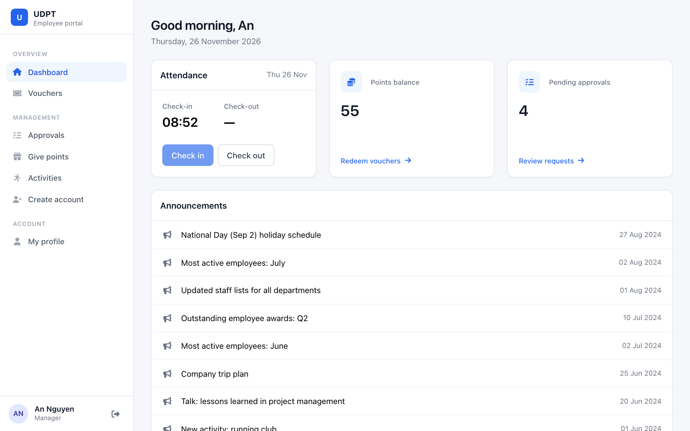
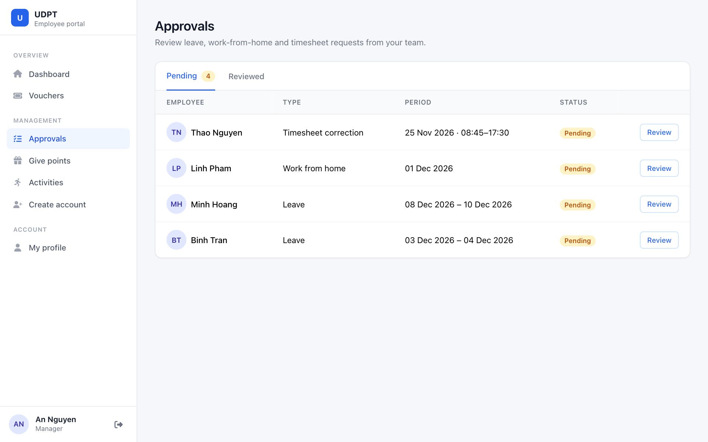
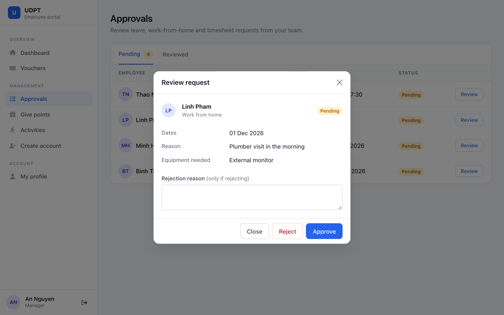
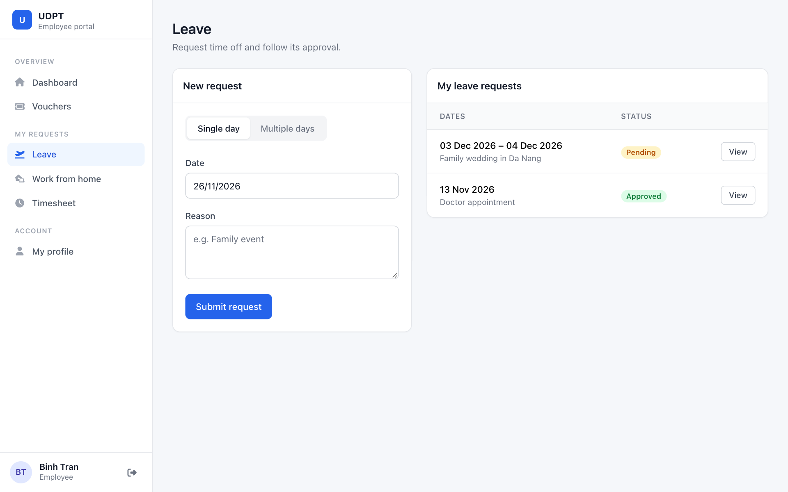
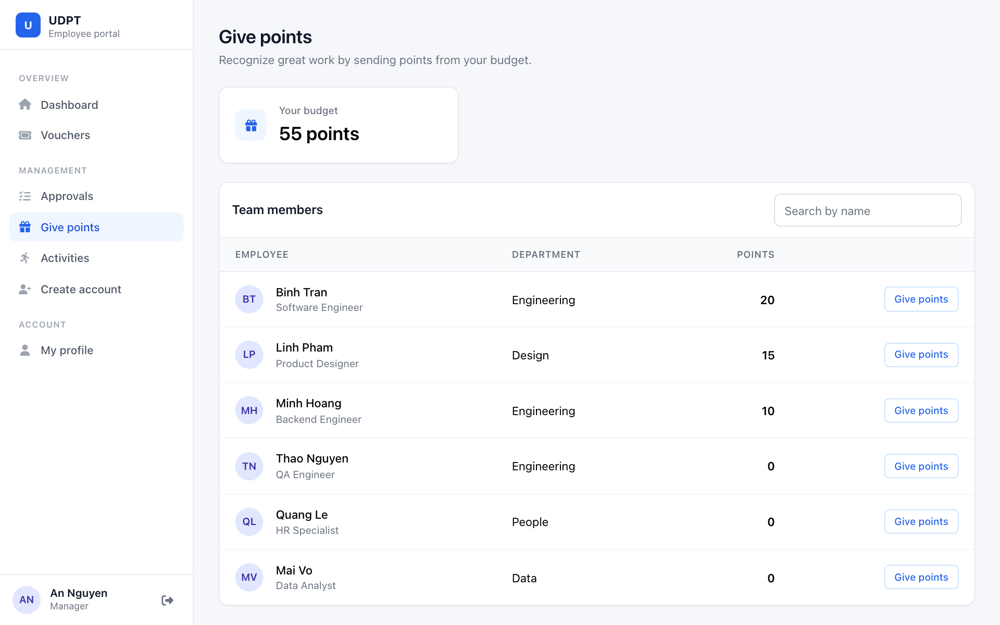
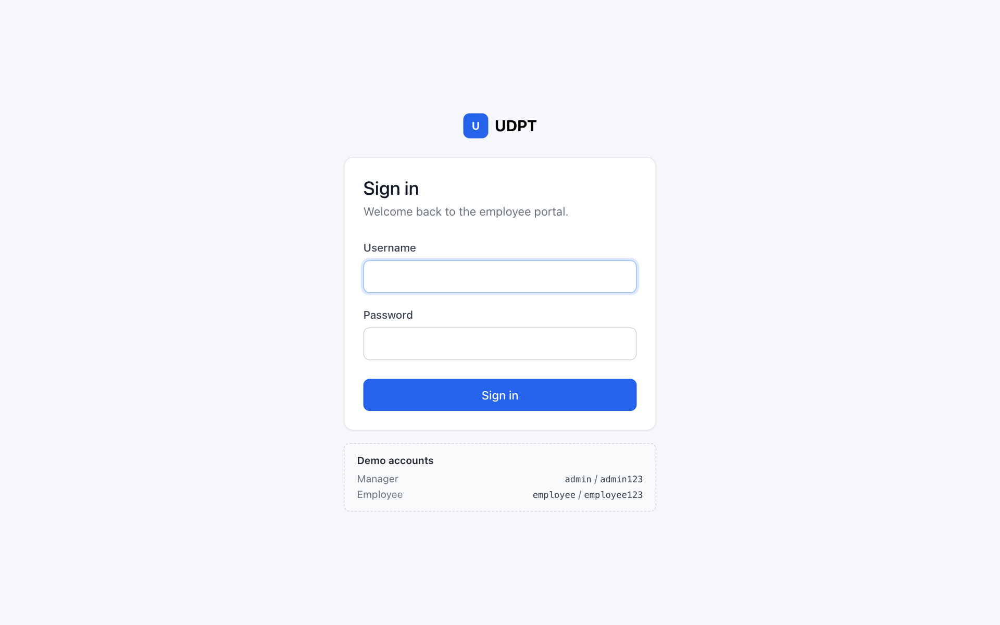
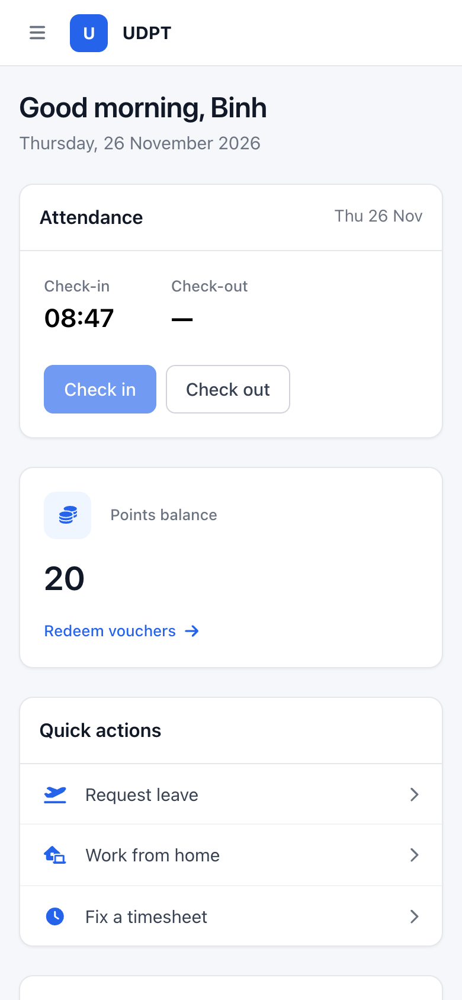
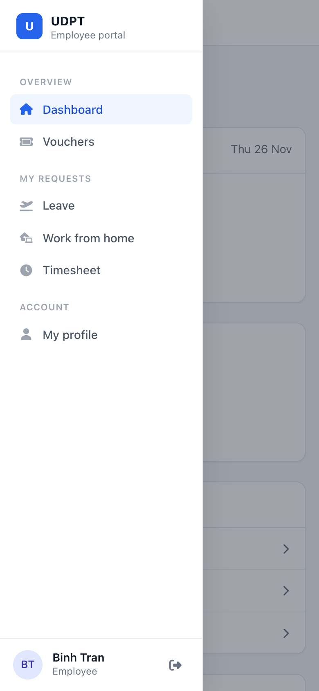
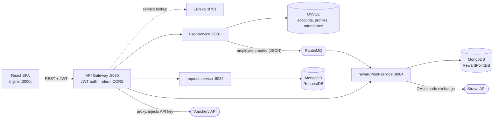

<div align="center">

# UDPT — Employee Management System

**A microservices HR portal: attendance, leave and work-from-home requests with manager approval, and a reward-points program with vouchers.**

[](https://github.com/mp2209/Employee-Management/actions/workflows/ci.yml)


</div>

UDPT (the Vietnamese abbreviation for "Distributed Applications") was built by a team of three
for a university distributed-systems course. It is split into independently deployable Spring Boot
services behind an API gateway, uses a different database per service, and communicates both
synchronously (REST through the gateway) and asynchronously (RabbitMQ events).



## Features

| Employees | Managers |
| --- | --- |
| Daily check-in / check-out | Approve or reject requests (timesheet fixes update attendance) |
| Leave, work-from-home and timesheet-correction requests | Create employee accounts (a one-time temporary password is generated) |
| Profile with avatar upload | Give reward points from their own budget |
| Points wallet with history; redeem points for vouchers | Add vouchers to campaigns; view the team's Strava club activities |

Every account gets a points wallet automatically, and everyone earns a monthly bonus.

## Screenshots

| Approval queue (manager) | Reviewing a request |
| --- | --- |
|  |  |

| Leave requests (employee) | Giving points (manager) |
| --- | --- |
|  |  |

| Sign in | On a phone |
| --- | --- |
|  |   |

## Architecture



| Service | Responsibility | Storage |
| --- | --- | --- |
| `api-gateway` | Single entry point: routing via Eureka, JWT verification, role checks, CORS, third-party proxy | — |
| `eureka-server` | Service registry | — |
| `user-service` | Accounts, login (issues JWTs), employee profiles, check-in/out | MySQL (JPA) |
| `request-service` | Leave / WFH / timesheet requests and the approval workflow | MongoDB |
| `rewardPoint-service` | Points wallets, transfers, redemptions, monthly bonus, Strava token exchange | MongoDB |
| `client` | React single-page app served by nginx | — |

**How a request flows:** the browser sends every call to the gateway with its JWT. The gateway
verifies the signature and expiry, enforces Manager-only routes, strips any client-supplied
identity headers, adds `X-User-Id` / `X-User-Role`, and routes to a service instance found in
Eureka. Services use those headers for ownership checks (for example, an employee can only read
their own profile and wallet).

**Event-driven provisioning:** when a manager creates an account, user-service saves the user and
profile in one transaction and, *after commit*, publishes an `employee.created` JSON event.
rewardPoint-service consumes it and opens the wallet idempotently, so a redelivered message
never duplicates a wallet.

## Quick start

Requires **Docker** (with Compose v2) and `make`.

```bash
git clone https://github.com/mp2209/Employee-Management.git
cd Employee-Management
make up
```

`make up` builds all images, starts MySQL, MongoDB, RabbitMQ and the six application
containers, and waits until every health check passes. Then open **http://localhost:3000**.

| Demo account | Password | Role |
| --- | --- | --- |
| `admin` | `admin123` | Manager (starts with 100 points to give) |
| `employee` | `employee123` | Employee |

Other useful URLs: Eureka dashboard http://localhost:8761, RabbitMQ console
http://localhost:15672 (`guest` / `guest`). Run `make smoke` to exercise the main API flows
end to end, and `make down` to stop everything.

## Make targets

Run `make help` for the full list.

| Command | What it does |
| --- | --- |
| `make up` / `make down` | Start or stop the whole stack in Docker |
| `make logs SERVICE=user-service` | Follow logs (all services if `SERVICE` is omitted) |
| `make smoke` | End-to-end smoke test through the gateway (auth, roles, events, points, approvals) |
| `make clean-data` | Stop the stack and delete its databases |
| `make infra` | Start only MySQL, MongoDB and RabbitMQ (for local development) |
| `make run-<service>` | Run one backend service with Maven, e.g. `make run-user-service` |
| `make dev-client` | React dev server with hot reload |
| `make test` | Backend tests plus client lint and build (what CI runs) |
| `make build` | Build backend jars and the client bundle |

## Local development

Run the infrastructure in Docker and the code on your machine (JDK 21 and Node 22+ needed; on
macOS the Makefile picks JDK 21 automatically if several JDKs are installed):

```bash
make infra                      # MySQL, MongoDB, RabbitMQ
make run-eureka-server          # then, each in its own terminal:
make run-api-gateway
make run-user-service
make run-request-service
make run-rewardPoint-service
make dev-client                 # http://localhost:3000
```

## Configuration

Copy `.env.example` to `.env` (`make env` does it); Docker Compose and the `make run-*`
targets both read it. Every setting has a working default for local use.

| Variable | Purpose |
| --- | --- |
| `JWT_SECRET` | HS256 key shared by user-service (signs) and the gateway (verifies); at least 32 bytes |
| `SEED_DEMO_DATA` | Create the demo accounts on first start (default `true`) |
| `VOUCHERY_API_KEY` | Optional: enables the voucher catalogue (the gateway adds the key server-side) |
| `STRAVA_CLIENT_ID`, `STRAVA_CLIENT_SECRET`, `STRAVA_CLUB_ID` | Optional: enables the Activities page |

Database and broker connection settings (`DB_URL`, `MONGO_HOST`, `RABBITMQ_HOST`, ...) default to
`localhost` and are set by `docker-compose.yml` inside Docker.

## API

All routes go through the gateway at `http://localhost:8080`. Errors share one JSON shape:
`{ "timestamp", "status", "error", "message" }`.

| Endpoint | Service | Who |
| --- | --- | --- |
| `POST /api/users/login` | user | Public; returns a JWT |
| `POST /api/users` | user | Manager; creates account + profile, returns a temporary password once |
| `GET\|PUT\|DELETE /api/users/**`, `GET /api/employees` | user | Manager |
| `GET\|PUT /api/employees/{id}`, `POST /api/employees/{id}/avatar` | user | Owner or Manager |
| `POST /api/employees/checkin`, `/checkout` | user | The user themselves |
| `PUT /api/employees/update-checkin-checkout` | user | Manager |
| `POST /api/requests`, `GET /api/requests/{id}`, `/leave`, `/update` | request | Any signed-in user |
| `GET /api/requests/not-approved`, `/approved`; `PUT /api/requests/{id}/approve`, `/reject` | request | Manager |
| `GET /api/points` | reward | Manager |
| `GET /api/points/{uid}` | reward | Owner or Manager |
| `POST /api/points/send` | reward | Manager, from their own wallet |
| `POST /api/points/redeem` | reward | The user themselves |
| `POST /api/activities/strava/token` | reward | Manager |
| `/api/vouchery/**` | Vouchery (proxied) | Signed-in users; adding vouchers is Manager-only |

Example:

```bash
TOKEN=$(curl -s -X POST localhost:8080/api/users/login -H 'Content-Type: application/json' \
  -d '{"username":"admin","password":"admin123"}' | jq -r .token)
curl -s localhost:8080/api/points/1 -H "Authorization: Bearer $TOKEN"
```

## Security and reliability

- **Authentication at the edge:** JWTs (HS256, `jjwt`) are issued by user-service and verified
  by a custom Spring Cloud Gateway `GlobalFilter`; role rules are enforced before routing.
- **No identity spoofing:** the gateway drops client-sent `X-User-*` headers. In Docker, the
  services publish no ports, so they are reachable only through the gateway.
- **Passwords:** BCrypt hashes only, never returned by the API; new accounts get a random
  temporary password shown once.
- **Points can't be overdrawn:** balances change only through single-document atomic MongoDB
  updates (`findAndModify` + `$inc` guarded by `totalPoint >= amount`), so concurrent
  redemptions cannot overspend and negative amounts are rejected. Transfers debit, then credit,
  and refund the sender if the credit fails.
- **Safe messaging:** events are JSON, never Java-serialized objects; they are published after
  the database commit, consumed idempotently, and retried 3 times before being dropped.
- **Secrets stay server-side:** the Vouchery API key and the Strava client secret never reach
  the browser bundle.

## Testing

| Layer | What is covered |
| --- | --- |
| Unit tests (JUnit 5, Mockito) | Gateway JWT filter and role rules, JWT issuing, password hashing, account creation, request workflow |
| Integration test (Testcontainers + MongoDB) | Wallet operations against a real database, including 50 concurrent redemptions that must never overdraw |
| Smoke test (`make smoke`) | 31 end-to-end checks through the gateway against the running Docker stack |
| CI (GitHub Actions) | Backend tests, client lint + build, and Docker image builds on every push |

## Project structure

```
.
├── Makefile                  # developer commands (make help)
├── docker-compose.yml        # infrastructure + all services
├── .env.example              # configuration template
├── scripts/smoke-test.sh     # end-to-end API checks
├── docs/screenshots/         # images used in this README
├── client/                   # React 18 SPA (Create React App), served by nginx
│   └── src/
│       ├── components/       # app shell (sidebar layout), shared UI pieces and dialogs
│       ├── containers/       # pages: Dashboard, Leave, Approvals, Give points, Vouchers, ...
│       ├── services/         # API clients (axios), auth, notifications, formatting helpers
│       └── styles/           # theme.scss: the design system on top of Bootstrap 5
└── server/                   # Maven multi-module build (shared parent POM)
    ├── Dockerfile            # one Dockerfile for every service (MODULE build arg)
    ├── api-gateway/
    ├── eureka-server/
    ├── user-service/
    ├── request-service/
    └── rewardPoint-service/
```

## Known limitations and next steps

- Services trust the gateway's identity headers. A production setup would also lock down the
  network (mTLS or a service mesh) or verify the JWT in every service.
- Events are published right after commit rather than through a transactional outbox, so a
  broker outage at that moment would need a manual retry.
- A standalone MongoDB has no multi-document transactions; running a replica set would let
  transfers use a real transaction instead of compensation.
- The request lists (`/leave`, `/update`) return all employees' requests and the client filters
  them; they should be filtered server-side by the caller.
- No refresh tokens (24-hour access tokens kept in `localStorage`); Create React App is
  deprecated and the client would move to Vite.

## Team

- **Minh Phan**: backend architecture and all microservices (gateway, Eureka, user, request and
  reward-point services, RabbitMQ), frontend API integration, DevOps
- **[tdkunz](https://github.com/tdkunz)** and **[datk1912](https://github.com/datk1912)**: React user interface
